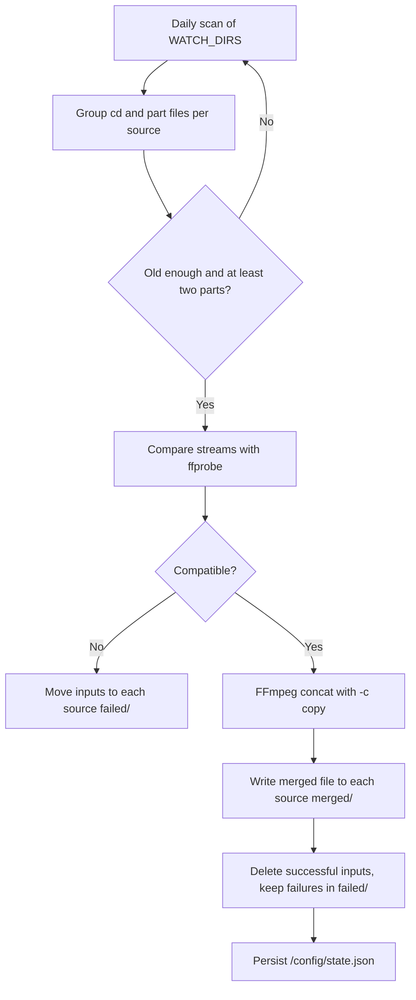

<div align="center">

# Lossless Merge

**A scheduled Docker service that finds split videos on a NAS and joins them with FFmpeg stream copy.**


</div>

## Overview

Lossless Merge watches a directory for numbered video segments, validates that their media streams are compatible, and merges them without re-encoding. Successful inputs are archived, failed groups are isolated, and a persistent state file prevents accidental duplicate processing.

## Workflow



### Features

- **Lossless joining** with FFmpeg concat and `-c copy`; no video or audio re-encoding.
- **Scheduled operation** at a configurable daily `HH:MM` time, with an optional startup scan.
- **Flexible file discovery** for `cd` and `part` names separated by dashes, underscores, dots, or spaces.
- **Sparse numbering support** and automatic placement of an unnumbered base file into the first available position.
- **Safety checks** for file age, duplicate part numbers, stream compatibility, and empty outputs.
- **Non-destructive failure handling**: failed inputs are moved to `failed/`; successful inputs are deleted after the merge (configurable).
- **Collision-safe archiving** that appends `.1`, `.2`, and higher suffixes instead of overwriting files.
- **Persistent processing state** stored outside the container in `/config/state.json`.
- **Isolated container** with `network_mode: none` and a minimal Python/FFmpeg image.

## Supported Names

Matching is case-insensitive and supports common separators:

```text
movie-cd1.mp4 + movie-CD2.mp4
movie-part1.mkv + movie-part2.mkv
movie_part1.mov + movie_part3.mov
movie.cd1.m4v + movie.cd2.m4v
```

Part numbers may be sparse. An unnumbered `movie.mp4` is assigned to the first missing position in the matching group.

## Quick Start

代码与个人配置分离：所有个人路径和 UID:GID 都写在 `docker-compose.override.yml` 中，
该文件不被 git 跟踪，因此更新代码时不需要重新填写配置。

### 1. 在 NAS 上克隆仓库

```bash
mkdir -p /volume1/docker
cd /volume1/docker
git clone https://github.com/guoyiheng/nas-auto-merge.git
cd nas-auto-merge/app
```

### 2. 创建个人配置（只需一次）

```bash
cp docker-compose.override.example.yml docker-compose.override.yml
vi docker-compose.override.yml    # 修改视频目录、UID:GID、config 目录
```

持久化状态目录（默认 `<repo>/config`）是 bind mount 的宿主目录，Docker 不会自动
创建。`./update.sh` 会自动创建并保证容器用户可写；如果你把它改成别的路径，需要
自己 `mkdir -p` 并确保 override 里 `user:` 指定的用户对它有写权限。

每个 NAS 源目录挂载到不同的容器路径，服务会在每个源目录内独立维护
`merged/`、`part/`、`failed/`。增加目录时，同时增加一条 `WATCH_DIRS` 路径和
一条 volume 挂载即可；不要把多个宿主目录挂到同一个 `/watch` 路径。

### 3. 启动

```bash
./update.sh
docker compose logs -f nas-auto-merge
```

## 更新代码

以后每次更新只需一条命令：

```bash
cd /volume1/docker/nas-auto-merge/app
./update.sh
```

`update.sh` 会自动 `git pull` 并重启容器；镜像已存在时跳过构建。源码通过
`./src:/app` 挂载进容器，更新后重启即生效；个人配置保存在
`docker-compose.override.yml`，不会被覆盖。改动过 `Dockerfile` 时，用
`./update.sh --build` 强制重建镜像。

启动日志会打印最终生效的监控目录，例如 `Watching 2 directories: /watch/source1, /watch/source2`。
如果日志中没有这行，或目录列表不正确，说明运行中的容器不是当前配置创建的容器。

Run an immediate one-time scan:

```bash
docker compose exec nas-auto-merge python /app/merge_watcher.py --run-once
```

### 构建时拉取 ffmpeg 缓慢

镜像里的 ffmpeg / ffprobe 不再从 GitHub Release 下载，而是通过多阶段构建从
Docker Hub 的 [`mwader/static-ffmpeg`](https://hub.docker.com/r/mwader/static-ffmpeg)
取（静态编译、无外部依赖）。

如果拉取失败或很慢，给群晖 Container Manager 配置 Docker Hub 镜像加速即可，
同时也会加速 `python:3.11-slim-bookworm` 基础镜像：
Container Manager → 注册表 → 设置 → 编辑 → 添加镜像加速地址。

注意：

- 一些早已停用的地址（如 `dockerhub.azk8s.cn`、`registry.docker-cn.com`、
  `docker.mirrors.ustc.edu.cn`）现在会返回 403 或超时，请从列表里删掉。
- 可用示例：`https://docker.1ms.run`、`https://docker.m.daocloud.io`；最稳的是
  阿里云个人加速器（登录 cr.console.aliyun.com → 镜像工具 → 镜像加速器，
  获取 `https://<id>.mirror.aliyuncs.com`）。
- 改完加速地址后需要重启 Container Manager / Docker 服务才生效。

验证：

```bash
docker pull mwader/static-ffmpeg:9.0.2-1
```

需要更换 ffmpeg 版本时用 `FFMPEG_IMAGE` 覆盖：

```bash
FFMPEG_IMAGE=mwader/static-ffmpeg:<tag> ./update.sh --build
```

仍失败时，通常是 Docker 本身出网被墙，需要给 Docker 守护进程配置代理，
或在 `docker-compose.yml` 的 `build:` 下临时加入 `network: host` 后重试。

这里使用 Compose 服务名 `nas-auto-merge`，不依赖群晖 Container Manager 为容器添加的项目名前缀。如果是在其他目录执行命令，请先切换到包含 `docker-compose.yml` 的目录，或加上对应的 `-f` 参数。

## Configuration

| Variable | Default | Description |
| --- | --- | --- |
| `WATCH_DIRS` | `/watch` | Comma-separated container directories to scan |
| `WATCH_DIR` | `/watch` | Backward-compatible single-directory setting |
| `MERGED_SUBDIR` | `merged` | Successful output subdirectory inside each source |
| `PART_SUBDIR` | `part` | Archive subdirectory for successful inputs when `DELETE_SOURCES_ON_SUCCESS` is `false` |
| `FAILED_SUBDIR` | `failed` | Archive subdirectory for failed inputs |
| `DELETE_SOURCES_ON_SUCCESS` | `true` | Delete source fragments after a successful merge; when `false`, they are archived to `part/` |
| `RUN_AT` | `02:00` | Daily scan time in 24-hour format |
| `RUN_ON_START` | `false` | Run one additional scan when the container starts |
| `MIN_FILE_AGE_SECONDS` | `300` | Ignore files that may still be copying |
| `MIN_PARTS` | `2` | Minimum files required for a group |
| `EXTENSIONS` | `.mp4,.mkv,.mov,.m4v,.ts` | Included media extensions |
| `RECURSIVE` | `false` | Scan subdirectories |
| `TZ` | `Asia/Shanghai` | Scheduler timezone |

Each configured source has independent `merged/`, `part/`, and `failed/` directories.
By default successful source fragments are deleted and only failures are kept in `failed/`.
Set `DELETE_SOURCES_ON_SUCCESS: "false"` to archive successful inputs in `part/` instead.
If a configured source does not exist, the container exits and logs the missing path.

## Project Structure

```text
nas-auto-merge/
└── app/
    ├── docker-compose.yml                  # 通用基础配置（不要改）
    ├── docker-compose.override.example.yml # 个人配置模板
    ├── docker-compose.override.yml         # 你的个人配置（不入库，由模板复制）
    ├── update.sh                           # 一键更新：git pull + 重启（可选重建）
    ├── docker/
    │   └── Dockerfile                      # Python + 静态 FFmpeg 镜像
    └── src/
        └── merge_watcher.py                # 发现、校验、合并与调度逻辑
```

## Technology Stack

| Layer | Technology |
| --- | --- |
| Runtime | Python 3.11 |
| Media inspection | ffprobe |
| Media merge | FFmpeg concat demuxer and stream copy |
| Scheduling | Built-in daily scheduler |
| Packaging | Docker Compose |
| Target environment | Synology NAS or any Docker host |

## License

Licensed under the [Apache License 2.0](https://www.apache.org/licenses/LICENSE-2.0).

<p align="center">© 2026 yiheng</p>
