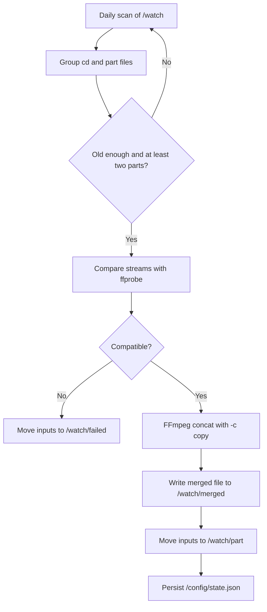

<div align="center">

# Lossless Merge

**A scheduled Docker service that finds split videos on a NAS and joins them with FFmpeg stream copy.**


</div>

## Overview

Lossless Merge watches a directory for numbered video segments, validates that their media streams are compatible, and merges them without re-encoding. Successful inputs are archived, failed groups are isolated, and a persistent state file prevents accidental duplicate processing.

## Workflow



### Features

- **Lossless joining** with FFmpeg concat and `-c copy`; no video or audio re-encoding.
- **Scheduled operation** at a configurable daily `HH:MM` time, with an optional startup scan.
- **Flexible file discovery** for `cd` and `part` names separated by dashes, underscores, dots, or spaces.
- **Sparse numbering support** and automatic placement of an unnumbered base file into the first available position.
- **Safety checks** for file age, duplicate part numbers, stream compatibility, and empty outputs.
- **Non-destructive source handling**: inputs are moved to `part/` after success or `failed/` after an error.
- **Collision-safe archiving** that appends `.1`, `.2`, and higher suffixes instead of overwriting files.
- **Persistent processing state** stored outside the container in `/config/state.json`.
- **Isolated container** with `network_mode: none` and a minimal Python/FFmpeg image.

## Supported Names

Matching is case-insensitive and supports common separators:

```text
movie-cd1.mp4 + movie-CD2.mp4
movie-part1.mkv + movie-part2.mkv
movie_part1.mov + movie_part3.mov
movie.cd1.m4v + movie.cd2.m4v
```

Part numbers may be sparse. An unnumbered `movie.mp4` is assigned to the first missing position in the matching group.

## Quick Start

1. Copy the `app/` directory to your NAS, for example `/volume1/docker/lossless-merge/app`.
2. Update the host video path and the container `user` in `app/docker-compose.yml`.
3. Create a persistent configuration directory.
4. Build and start the service.

```bash
mkdir -p /volume1/docker/lossless-merge/config
cd /volume1/docker/lossless-merge/app
docker compose up -d --build
docker compose logs -f
```

Run an immediate one-time scan:

```bash
docker exec nas-auto-merge python /app/merge_watcher.py --run-once
```

## Configuration

| Variable | Default | Description |
| --- | --- | --- |
| `WATCH_DIR` | `/watch` | Root directory to scan |
| `MERGED_DIR` | `/watch/merged` | Successful output directory |
| `PART_DIR` | `/watch/part` | Archive for successfully merged inputs |
| `FAILED_DIR` | `/watch/failed` | Archive for failed inputs |
| `RUN_AT` | `02:00` | Daily scan time in 24-hour format |
| `RUN_ON_START` | `false` | Run one additional scan when the container starts |
| `MIN_FILE_AGE_SECONDS` | `300` | Ignore files that may still be copying |
| `MIN_PARTS` | `2` | Minimum files required for a group |
| `EXTENSIONS` | `.mp4,.mkv,.mov,.m4v,.ts` | Included media extensions |
| `RECURSIVE` | `false` | Scan subdirectories |
| `TZ` | `Asia/Shanghai` | Scheduler timezone |

## Project Structure

```text
lossless-merge/
└── app/
    ├── docker-compose.yml   # Runtime configuration and NAS mounts
    ├── docker/
    │   └── Dockerfile       # Python, FFmpeg, and tini image
    └── src/
        └── merge_watcher.py # Discovery, validation, merge, and scheduler
```

## Technology Stack

| Layer | Technology |
| --- | --- |
| Runtime | Python 3.11 |
| Media inspection | ffprobe |
| Media merge | FFmpeg concat demuxer and stream copy |
| Scheduling | Built-in daily scheduler |
| Packaging | Docker Compose |
| Target environment | Synology NAS or any Docker host |

## License

Licensed under the [Apache License 2.0](https://www.apache.org/licenses/LICENSE-2.0).

<p align="center">© 2026 yiheng</p>
